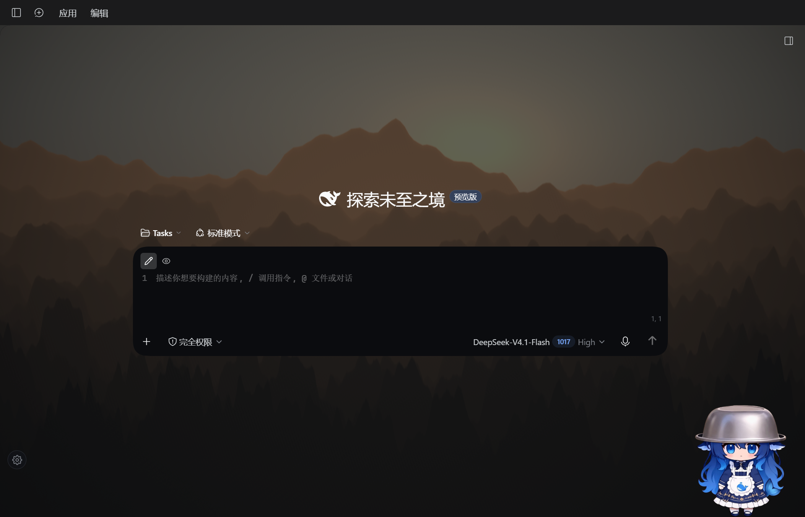
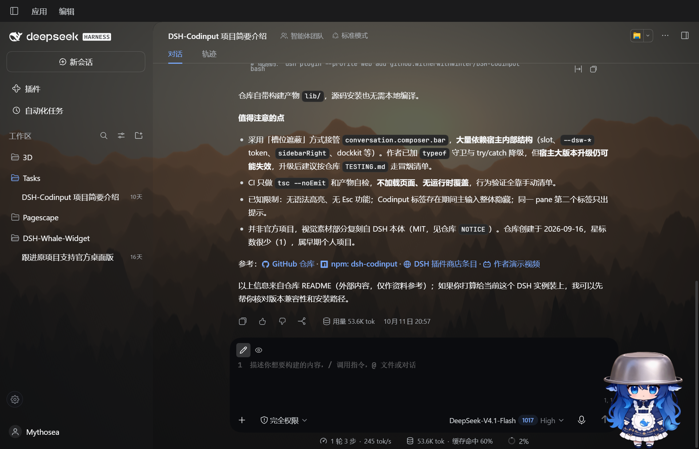
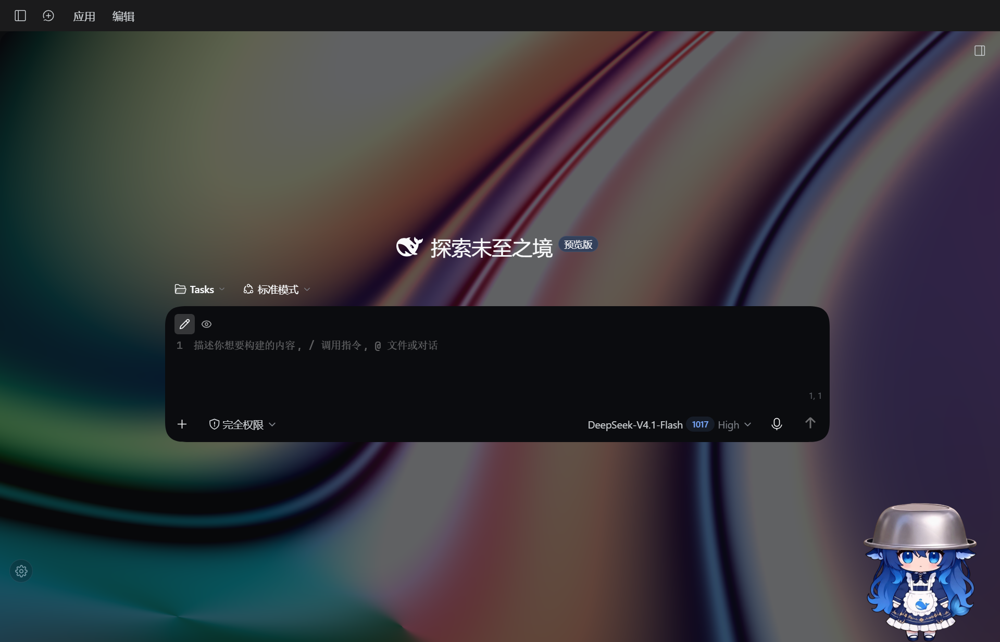
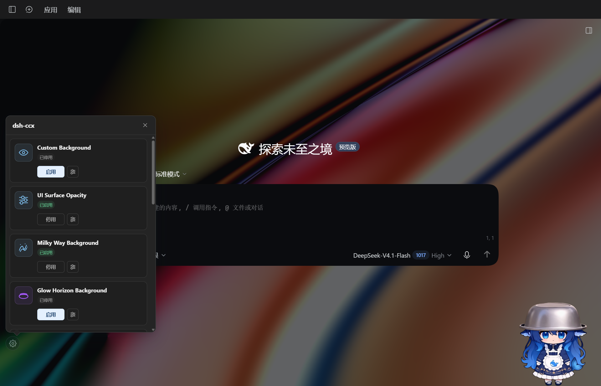
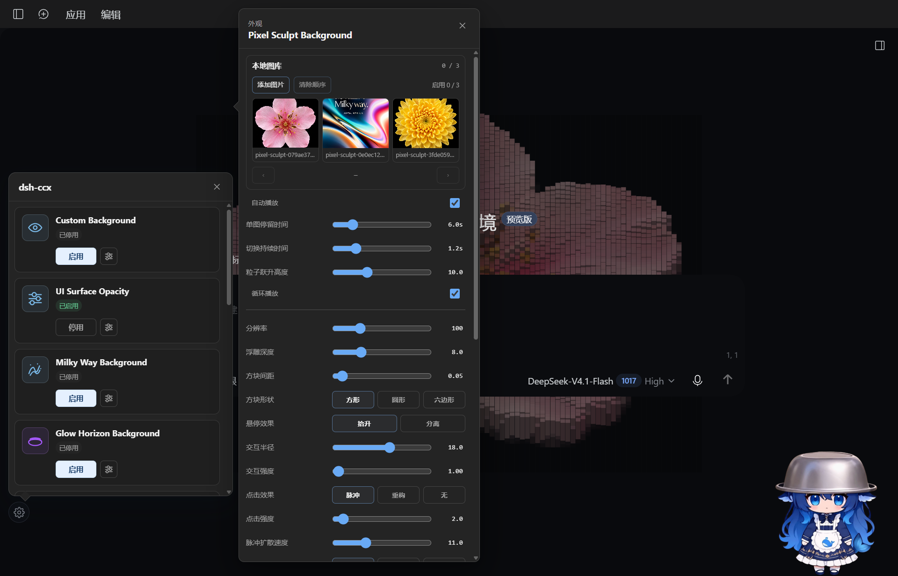
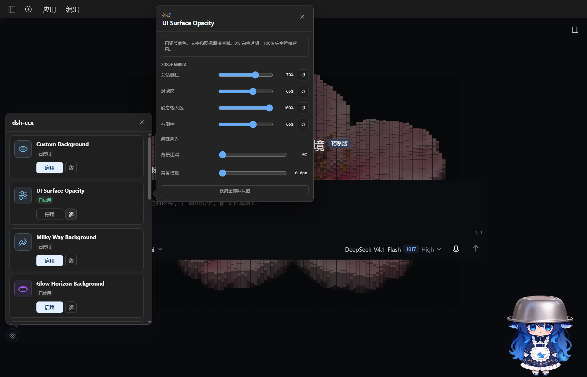
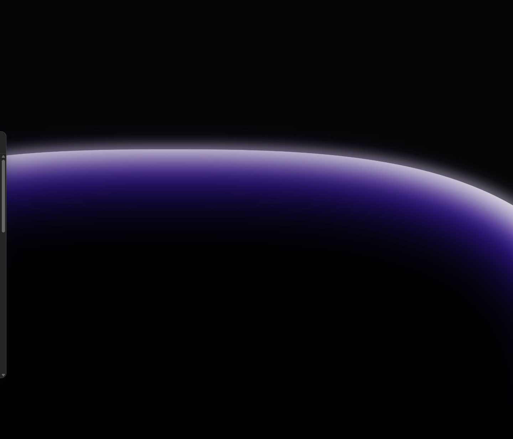
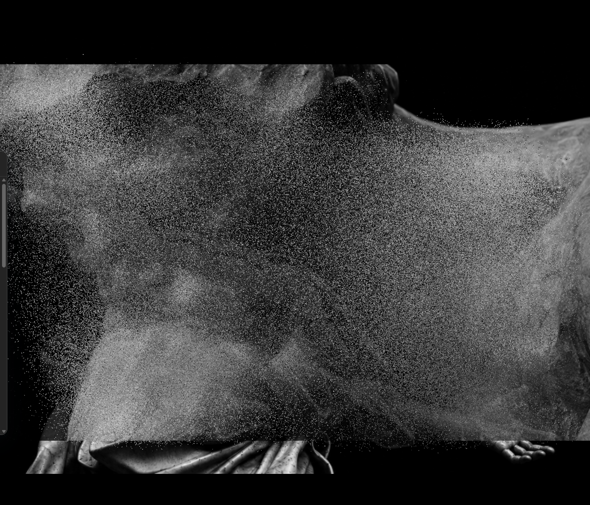
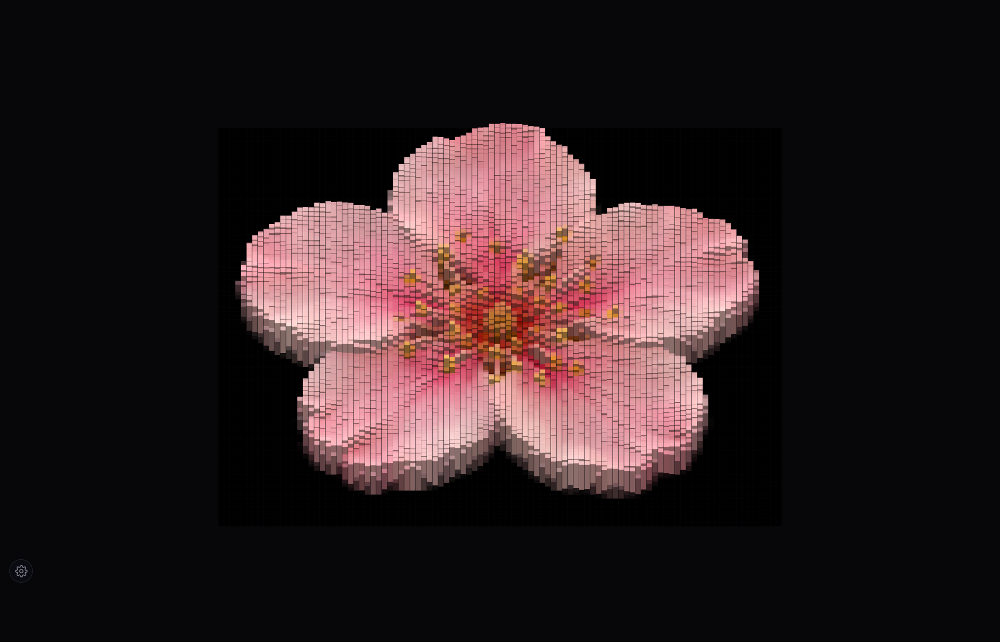
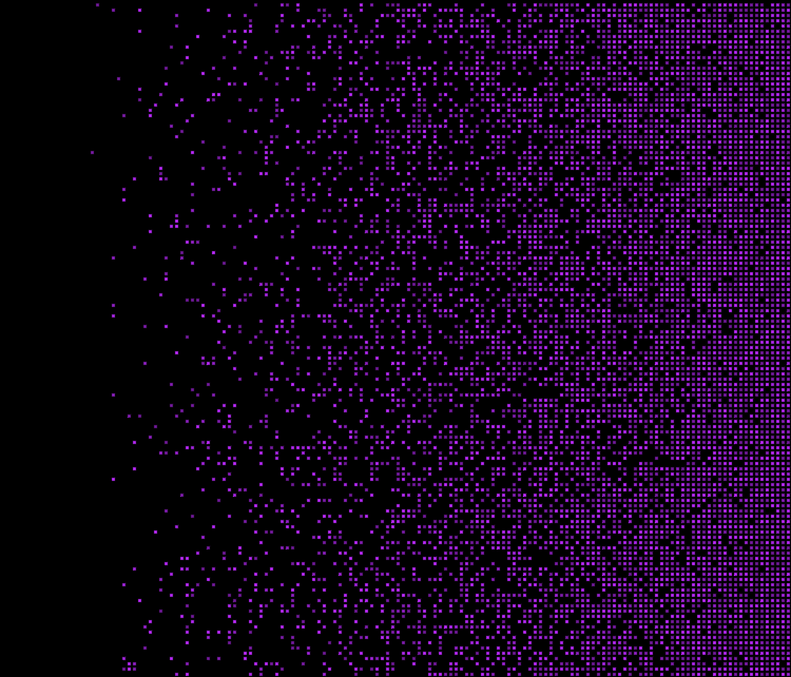

<p align="center">
  
</p>

<h1 align="center">dsh-ccx</h1>

<p align="center">
  <a href="https://www.npmjs.com/package/dsh-ccx"></a>
  <a href="https://github.com/deepseek-ai/deepseek-harness"></a>
  <a href="https://github.com/Witherwithwinter/dsh-ccx/stargazers"></a>
  <a href="./LICENSE"></a>
</p>

<p align="center">给 DeepSeek Harness 桌面版换上动态背景：10 种场景渲染器、壁纸素材库、UI 表面分区透明，外加一个逐像素复刻的 Appearance 设置面板。</p>

<table>
  <tr>
    <td width="50%"><br /><sub>层峦（Layered Mountain）· 新会话页</sub></td>
    <td width="50%"><br /><sub>层峦 · 对话页（表面分区透明 + 输入面板）</sub></td>
  </tr>
  <tr>
    <td width="50%"><br /><sub>银河光场（Milky Way）· 对话页</sub></td>
    <td width="50%"><br /><sub>Appearance 面板（dsh-ccx 弹层，卡片式外观列表）</sub></td>
  </tr>
  <tr>
    <td width="50%"><br /><sub>场景设置 popover（预设档 / 分组滑杆 / 调色板）</sub></td>
    <td width="50%"><br /><sub>UI Surface Opacity —— 分区不透明度滑杆</sub></td>
  </tr>
</table>

## 特性

**10 种动态场景**——渲染器 1:1 来自 [Rice-dog/code-codex](https://github.com/Rice-dog/code-codex) 的 Appearance 系列（MIT，见[第三方归属](#第三方归属)）：

| 效果 | 场景 | 说明 |
| --- | --- | --- |
|  | 银河光场 Milky Way | 旋转星系 + 五色调色板 + 开场动画 |
|  | 辉光地平线 Glow Horizon | 地平线辉光，方向四选、滚轮惯性 |
|  | 层峦 Layered Mountain | 视差山脊 + 日照着色，渲染比例可调 |
|  | 云穹 Heavenly Cloud | 云层穹顶，三档渲染质量 |
|  | 极光电离层 Aurora | 极光帘 + 电离层波动 |
|  | 黑洞 Black Hole | 吸积盘/光线/渲染器分组，影院/透镜/余烬三预设 |
|  | 云列车 Cloud Train | 列车车窗视角的云海，三染色可调 |
|  | 粒子成像 Particle Image | 把图片采样成 56 万粒子，支持本地图库、自动轮播、鼠标交互、开场汇聚 |
|  | 像素雕塑 Pixel Sculpt | WebGL2 实例化浮雕方块，图片高度场 + 指针涟漪，自带完整参数面板 |
|  | 闪烁方块 Blinking Squares | 方块矩阵闪烁波纹，方向四选、键盘随机波纹 |

- **壁纸 / 视频素材库**：导入图片或 MP4/WebM，铺满 / 完整显示 / 平铺三种适配，与场景互斥切换。
- **实时生效**：所有参数调整直接推给运行中的渲染器（上游 `updateSettings` 同语义）——不重建舞台、不重播开场动画。
- **UI Surface Opacity**：通配透明让界面底色让位给背景，四个分区（会话侧栏 / 对话区 / 消息输入区 / 右侧栏）独立滑杆调节不透明度，外加背景压暗与模糊；**停用后输入框恢复原生样式**，圆角交界的缺口自动补齐，输入卡片周边的原生阴影与座位渐变也一并清理（透明背景下不会显出灰框）；**DSH 自己的设置页不受影响**——设置面板保持宿主原生样式，背景照常透出。
- **Appearance 面板**：左下角齿轮弹出——12 张外观卡片（10 场景 + 壁纸 + 表面蒙版）+ 场景设置 popover，结构对齐 code-codex 0.5.7 真实 UI；启用某外观时已打开的设置面板自动关闭（上游交互语义）。
- **设置双端同步**：全部状态落宿主 `state.json`，多窗口 / 重启后一致；场景参数只存增量，渲染器内嵌默认值始终是真值。

## 安装

要求：DeepSeek Harness **桌面版**（版本见[兼容性](#兼容性)）。仓库自带构建产物 `lib/`，所有安装方式都**不需要本地构建**。

### 方法 A：让 DSH 安装 npm 包

在 DSH 桌面版的会话里直接让它安装：

```text
安装 npm 包 dsh-ccx
```

DSH 的 plugin_manager 会解析包的 `dsh.bundle` 元数据并装配进 desktop profile。装完**重启 DSH 桌面版**生效。

### 方法 B：GitHub 源码

```text
安装 github:Witherwithwinter/dsh-ccx
```

同样重启生效。

### 方法 C：手工编辑 profile（等价于方法 A）

编辑 `~/.dsh/profiles/desktop/package.json`：

```jsonc
{
  "dependencies": {
    "dsh-ccx": "^0.8.9"                // 本地开发用 "link:/abs/path/to/dsh-ccx"
  },
  "dsh": {
    "profile": {
      "bundles": [
        // ...既有 bundles...
        "dsh-ccx"                      // ← 追加在最后
      ]
    }
  }
}
```

然后在 profile 目录里 `pnpm install`，重启 DSH 桌面版。

> 桌面 profile 没有 web 端的 `patchReload: live` 热装配，**改配置、升级插件都需要重启 DSH**。升级插件代码本身（`lib/client.js`）后仅强刷页面不够——客户端按包版本号缓存，需要重启 DSH 或升版本号。

左下角齿轮 ⚙ 弹出 Appearance 面板。

## 兼容性

| 宿主 | 状态 |
| --- | --- |
| DSH 桌面版（Electron，`0.2.1-rc.2`） | ✅ 实机长期使用，全部功能端到端验证 |

插件对宿主内部结构有依赖（`data-slot` 布局锚点及其父级容器、宿主 webserver 路由、`state.json` 存储契约），已做 `typeof` / `try/catch` 降级，但宿主大版本升级仍可能失效。与宿主主题 / 皮肤插件的关系：本插件通过 `@layer` 级联 + CSS 变量控制表面底色，不覆写 `--dsw-*` token，皮肤插件改 token 不会与它冲突。

与 [DSH-Codinput](https://github.com/Witherwithwinter/DSH-Codinput) 协作：安装 Codinput 后，「消息输入区」蒙版精确命中它的编辑器卡片（`[data-composer-card]`），普通 / 悬浮 / 侧栏三种形态都跟随；未安装 Codinput 时输入区由对话区蒙版兜底。

## 已知限制

- **原生菜单栏（应用 / 编辑）不参与透明化**：它是 Electron 非客户区，页面 CSS、bundle 进程、desktop-host 都不可达——背景从窗口内容区顶部开始，不含 OS 菜单条。需要 DSH 本体配合（不设应用菜单或 `win.setMenu(null)`）。
- **窗口完全遮挡 / 最小化到托盘时场景暂停渲染**：Chromium 原生遮挡检测让页面进入 hidden，渲染器停帧（上游 code-codex 同语义）；窗口恢复可见即继续。刚唤出的一瞬可能看到合成残影，属显示层暂态。
- **Particle Image 首次启用需要图库**：默认图库自动播种到 IndexedDB；若「图库未就绪」，重启一次 DSH 让播种完成即可。
- **Pixel Sculpt 的设置在未启用时也可调**（实时写入并持久化，下次启用生效），「暂停动画」开关仅在场景启用中可用——与上游面板行为一致。
- 变形曲线（Particle Image 的 morph curve）以数值行呈现，未实现上游的曲线编辑器；开机恢复的上架过渡动画（startup transition）未移植。
- web 端 DSH 未适配、未测试。

## 开发

```bash
npm install
node test/host-smoke.test.mjs   # 宿主半侧冒烟：路由、schema 真值锚点、设置规整
```

- `lib/index.js` 是宿主半边（cordis 插件，注册 `/dsh-ccx` 与 `/dsh-appearances/*` 数据路由：状态读写、壁纸上传删除、vendor 场景脚本与图库媒体下发）。
- `lib/client.js` 是客户端半边（注入页面）：背景层与场景生命周期、通配透明 + 分区蒙版、Appearance 面板（Shadow DOM）、设置保存与轮询。
- `lib/vendor/code-codex/` 是上游场景渲染器的构建产物与默认图库，**原样包含、不做修改**（`tools/gen-scene-schemas.cjs` 从上游源码机械提取字段真值）。
- `tools/` 是开发辅助脚本：CDP 面板/场景采集、上下游逐帧对比（pixelmatch）、宿主窗口恢复等；`tools/cdp.cjs` 是调试用 CDP 助手（宿主需带 `--remote-debugging-port=9222` 启动）。
- `tmp-code-codex/`（上游完整克隆，调试对照用）不入库。

## 第三方归属

- **场景渲染器**（`lib/vendor/code-codex/`，含默认图库图片与字段真值）：来自 [Rice-dog/code-codex](https://github.com/Rice-dog/code-codex)（MIT License），按原样分发，构建产物内嵌的许可与第三方声明已保留。
- **视觉复刻**：设置面板与表面样式复刻 DeepSeek Harness（`@deepseek-ai/dsh`，MIT License，Copyright (c) 2026 DeepSeek）的真实 UI。本项目与 DeepSeek、code-codex 均无隶属或背书关系。

以上原始版权与许可声明见 [NOTICE](./NOTICE)。

## 许可

[MIT](./LICENSE)
