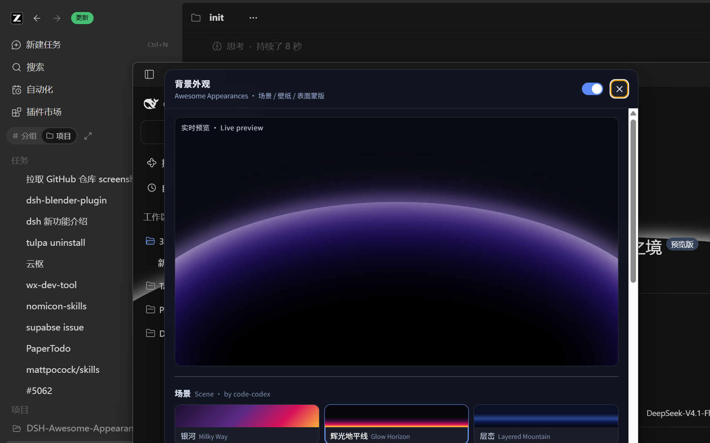
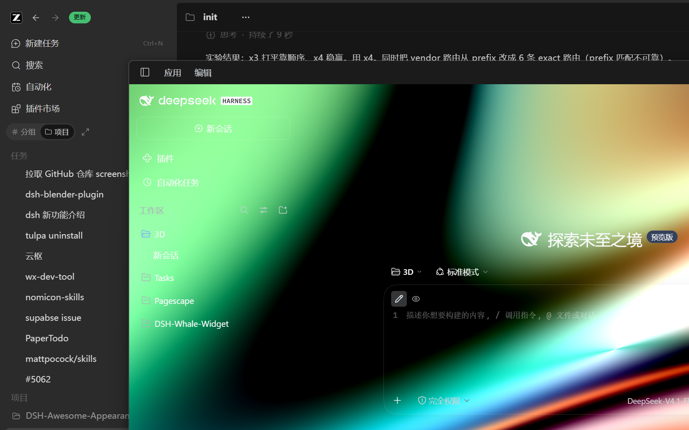
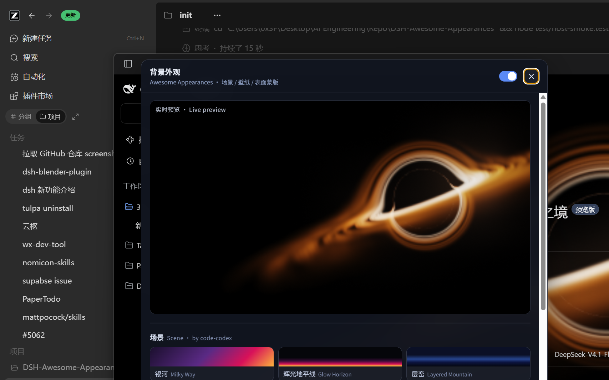
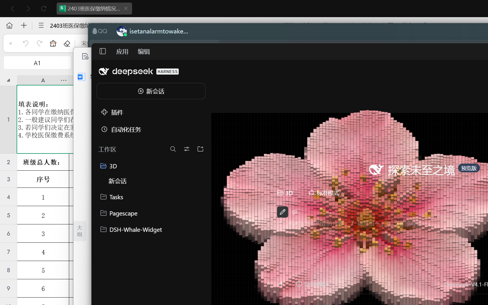

# dsh-ccx

> 灵感与效果均来自 [Rice-dog/code-codex](https://github.com/Rice-dog/code-codex) 给 Codex Desktop 做的 Preview Market「Appearance」背景插件（动态 GPU 背景 / Custom Background / UI Surface Opacity / Transparent Background）。本仓库把**同一套效果**带给 DeepSeek Harness（DSH）桌面版 / Web 版：场景渲染器直接 vendor 原仓库首方 Appearance 包，表面方案照搬原仓库两层设计，全部走 DSH 官方插件机制（bundle + client 双侧，零 index 注入、零 CDP、零打包器）。

**DSH 界面背景主题插件 v0.3**：六种原版 WebGL/DOM 动态场景、本地壁纸/视频素材库、通配透明 + 分区表面蒙版、实时预览设置面板。设置持久化在 `$DSH_HOME/appearances/`，桌面端与 Web 端共用一份、双开自动同步。


## 功能

### ① 动态背景场景（原仓库全部 10 种，渲染器 1:1，`lib/vendor/code-codex/`）

| 场景 | 说明 |
|---|---|
| 银河 Milky Way | 五色谐波光场（WebGL 片元着色器，Shadertoy 风） |
| 辉光地平线 Glow Horizon | 分层弧光 + screen 混合拖尾 |
| 层峦 Layered Mountain | 双阶段 WebGL 2 山脉 |
| 云穹 Heavenly Cloud | 无纹理实时光线步进云隧道 |
| 极光电离层 Aurora Ionosphere | 三阶段 WebGL 极光 |
| 黑洞 Black Hole | 光线步进黑洞（引力透镜 + 吸积盘 + 光子环） |
| 云列车 Cloud Train | 粒子层框架云雾列车 |
| 粒子成像 Particle Image | 默认图库 6 张图片粒子化（含樱花等，首启导入 IndexedDB） |
| 像素雕塑 Pixel Sculpt | 默认图库 3 张图片像素体雕塑 |
| 闪烁方块 Blinking Squares | 方块闪烁波浪 |

实现方式：原仓库每个场景把渲染器注册在
`window[Symbol.for("code-codex:background-modules:v1")]`。宿主契约是
`startup(target, onError)`——**第二参是错误回调，设置不走这个参数**，各渲染器从自己的
localStorage store（`code-codex:<id>-background:v1` 等）读配置、自带
Resize/可见性/掉上下文/reduced-motion 处理。本插件在运行时从
`/dsh-appearances/vendor/<id>.js` 懒加载渲染器，把速度/质量写进对应 store，
调用 `startup`/`dispose` 管理生命周期；particle-image / pixel-sculpt 需要先按
`code-codex:default-galleries:v1` 协议播种默认图库（`prepareDefaults()`，
sha256 校验通过后导入 IndexedDB，约 14MB 首启一次）。

### ② 壁纸

导入本地图片（png/jpg/webp/gif/bmp/avif）或视频（mp4/webm/mov，≤200MB）；
铺满/完整/平铺 + 五种锚点；视频自动静音循环。

### ③ UI 表面（原仓库两层设计，适配 DSH）

1. **通配透明**（transparent-background 同款，选择器本就是泛型的）：
   `body` 下全部结构元素 `background-color: transparent !important`、`backdrop-filter: none`，
   背景层完整透出；
2. **分区蒙版**（surface-opacity 同构）：用 DSH 稳定的 `data-slot` 布局钩子
   （`sidebar` / `main` / `rightbar` / `conversation.header` / `conversation.input.dock`），
   每个区域一块 `rgba(底色, var(--ap-mask-*))` 蒙版，不透明度 0–100% 独立可调
   （默认值对齐原仓库：会话侧栏 66 / 对话区 58 / 输入区 86 / 标题栏 78 / 右侧栏 66）。
   蒙版规则重复 `data-ap-masks` 四次到 (0,5,2) 特异性，稳定压过通配透明规则的 (0,4,2)
   （原仓库同款手法——它的通配选择器带三个 `:not()`，实际特异性很高）。

> v0.2 的 `overrideTokens` 方案已废弃：只盖五个别名 token 盖不全 DSH 的真实表面，效果不对。

### ④ 设置面板（对齐原仓库 Appearance 设置窗，应用制）

左下角齿轮（Shadow DOM）：760px 大面板 + **实时预览舞台**（同款渲染器跑在 640×360 小盒里）+ 场景卡 +
**场景设置抽屉**：预设质量三档（质量/均衡/性能）、每场景双语参数滑杆（字段/范围/默认值取自
各渲染器的设置 schema：milky-way 为官方逐字中文标签）、五色色板（银河/辉光地平线/层峦）、
**应用 / 重置**按钮——调节进草稿，点「应用」一次性写 store 并重建（不闪烁，同原版交互）；
素材库分页；表面蒙版分区滑杆。Esc / 点外面关闭。

## 安装（官方桌面版）

桌面端的 `desktop` profile 由客户端独占管理，**不能用** `dsh plugin --profile desktop`。两种方式：

### 方式 A：让 DSH 自己装（推荐，走官方 plugin_manager）

在桌面端随便开一个会话，对 DSH 说：

> 帮我安装本地插件 `dsh-ccx`，spec 用 `link:C:/Users/0x3F/Desktop/AI Engineering/Repo/DSH-Awesome-Appearances`

### 方式 B：手工装配（关掉桌面端后）

1. 编辑 `~/.dsh/profiles/desktop/package.json`：

   ```jsonc
   {
     "dependencies": {
       "dsh-ccx": "link:C:/Users/0x3F/Desktop/AI Engineering/Repo/DSH-Awesome-Appearances"
     },
     "dsh": { "profile": { "bundles": [ "...原有项...", "dsh-ccx" ] } }
   }
   ```

2. 在 profile 目录执行 `pnpm install`；启动桌面端。

### Web 版（dsh web）

```bash
dsh plugin --profile web add link:"/path/to/DSH-Awesome-Appearances"
```

## v0.6.0：与原版逐帧对齐（parity rework）

以「原版效果一模一样」为目标的一次全面校准。真值全部来自本仓库 `tmp-code-codex/` 克隆（上游 explorer-ui 源码），并在原版环境（Code-Codex 0.5.7 + ChatGPT/Codex 桌面版）实机采集了 10 场景基准（`docs/reference/`）。

- **默认值真值化**：`tools/gen-scene-schemas.cjs` 从上游 `core/configuration/explorer.ts`（每场景双语控制表）与 `startup-background-renderers.ts`（`DEFAULT_*_BACKGROUND_SETTINGS`）逐字提取，重新生成 `scene-schemas.json` / `scene-defaults.json`。修复了 v0.5 里 glow-horizon/mountain/heavenly-cloud/black-hole/blinking-squares 五个场景拿错模板的默认值与滑杆表；补齐 black-hole 影院/透镜/余烬三预设。
- **渲染 store 只写增量**：客户端不再预写全量默认值（渲染器内嵌默认值即渲染真值）——v0.5 的预写会把错误值永久固化进 localStorage。带一次性迁移清掉被污染的 8 个场景键。「应用」提交改为稀疏增量，全默认时清 store 键（真正的恢复原版默认）。
- **宿主层对齐上游**：层底色按场景取自上游各控制器（银河族 `#02090d`、云穹 `#020408`、黑洞/闪烁/粒子 `#000`、辉光地平线 `#050507`、像素雕塑 `#07070a`）；去掉默认 0.28 压暗层（原版没有）；表面蒙版默认对齐原版两档 `rgba(11,12,15,.58)` / `rgba(16,17,20,.66)`、标题栏透明。
- **级联层重构表面 CSS**：`@layer dsh-ap-assert > dsh-ap-masks > dsh-ap-clear`（`!important` 层间反转优先级），通配透明用 `:not(#dsh-ap-layer):not(#dsh-ap-layer *)` 排除背景层子树——v0.5 的通配规则会把场景内部画的背景一并清掉（辉光地平线的 blend 穹顶因此只剩灰边）。
- **设置抽屉按原版重建**：分组段落（相机/吸积盘/光线/渲染器、云场/电离层、输入/下滑/上滑/释放回弹…）、双语 label + hint、precision/单位格式化（如 `24.0 rH`）、百分号字段、布尔开关行、键控颜色行、五色调色板、black-hole 三预设按钮；无质量档的场景隐藏质量段。
- **基准与比对工具链**：`tools/codex-reference-sweep.cjs`（原版实机逐场景采集）、`tools/reference-shot.cjs` + `reference-harness/`（同字节渲染器受控复现）、`tools/compare-scenes.cjs`（pixelmatch 报告）、`tools/dsh-scene-capture.cjs`（DSH 实机纯场景采集）。结论存 `docs/reference/compare*.md`：确定性场景（辉光地平线几何探针 ±3px、层峦 0.4%）一致，时变场景差异为动画相位噪声。

### 原版基准采集（复现步骤）

1. 安装 [Code-Codex 0.5.7](https://github.com/Rice-dog/code-codex/releases)（校验 `SHA256SUMS.txt`；它会接管 Codex/ChatGPT 快捷方式，卸载即还原）。
2. 离线导入插件：`CodeCodex-0.5.7.exe plugins --import-dir <克隆>/releases`（逐字节 SHA 校验后入缓存）。
3. 用桌面 Code-Codex 快捷方式启动官方应用（启动器自带调试监听，`netstat` 找 `--remote-debugging-port`）。
4. `node tools/codex-reference-sweep.cjs <port> <targetId>`——注意**窗口被遮挡时 Chromium 节流 rAF**，启用流程会卡死，脚本会自动调 `tools/restore-chatgpt-window.ps1` 置前。

## 排障（实测经验）


- **装完没效果？先重启一次客户端。** 桌面壳把宿主启动时收集的 index 注入表（含客户端模块引导图）**缓存一次、无刷新路径**。插件在宿主运行中装配的，当次启动引导图里没有你。
- **保存与读取是两条路由**：宿主 webserver 路由表不区分 HTTP method 且同路径只能注册一条，保存走 `/state-save.json`、读取走 `/state.json`。客户端千万别把 POST 打回 `/state.json`——会命中 GET 处理器拿旧状态并静默回滚（v0.1.x "设置调不了"的根因）。
- **Shadow DOM 面板的外点关闭必须用 `event.composedPath()`**：document 捕获层只能看到宿主元素，按 `e.target` 判断会把面板内点击当外部点击（v0.1.x "面板点一下就消失"的根因）。
- **蒙版压过通配透明靠级联层**：表面 CSS 写在 `@layer dsh-ap-assert > dsh-ap-masks > dsh-ap-clear` 三个级联层里（`!important` 声明在层间反转优先级），蒙版恒胜通配；通配规则用 `:not(#dsh-ap-layer):not(#dsh-ap-layer *)` 排除背景层子树，否则场景内部画的背景（如辉光地平线的 blend 穹顶）会被清掉丢色。
- **webserver 的 prefix 路由匹配不可靠**：vendor 场景文件按场景 id 逐条注册 exact 路由。
- 桌面宿主 webserver 端口每次启动随机（`netstat` 找宿主进程的 127.0.0.1 端口），`curl http://127.0.0.1:<port>/dsh-appearances/state.json` 返回 JSON 即宿主半侧在线。
- 设置与壁纸数据在 `~/.dsh/appearances/`，删包不删数据，清干净就删目录。

## 文件结构

```
package.json            dsh.bundle.patch + dsh.client{platform:web} + exports["./client"]
cordis.patch.yml        bundle 层：insert 一行（宿主半侧入口）
lib/index.js            宿主半侧：设置读写、vendor 场景路由、壁纸上传/服务、信任栅栏
lib/vendor/code-codex/  原仓库全部 10 种场景渲染器 + 画廊图片（MIT，含 THIRD_PARTY_NOTICES）
lib/client.js           浏览器半侧：渲染器生命周期、通配透明+分区蒙版、Shadow DOM 面板
test/host-smoke.test.mjs     宿主半侧冒烟测试（node test/host-smoke.test.mjs）
tools/cdp-*.js          实机调试工具（需桌面端 --remote-debugging-port=9222）
docs/                   桌面端实机截图
```

## 实机截图









## 致谢与许可

- 场景渲染器与效果设计来自 [Rice-dog/code-codex](https://github.com/Rice-dog/code-codex)（MIT，另见 `lib/vendor/code-codex/THIRD_PARTY_NOTICES_EN.md` 的第三方视觉出处声明）。
- 本仓库其余代码 MIT。

## 测试

```bash
node test/host-smoke.test.mjs   # 宿主路由/设置/壁纸/vendor/信任栅栏 全链路断言
node --check lib/client.js      # 客户端半侧语法
```
